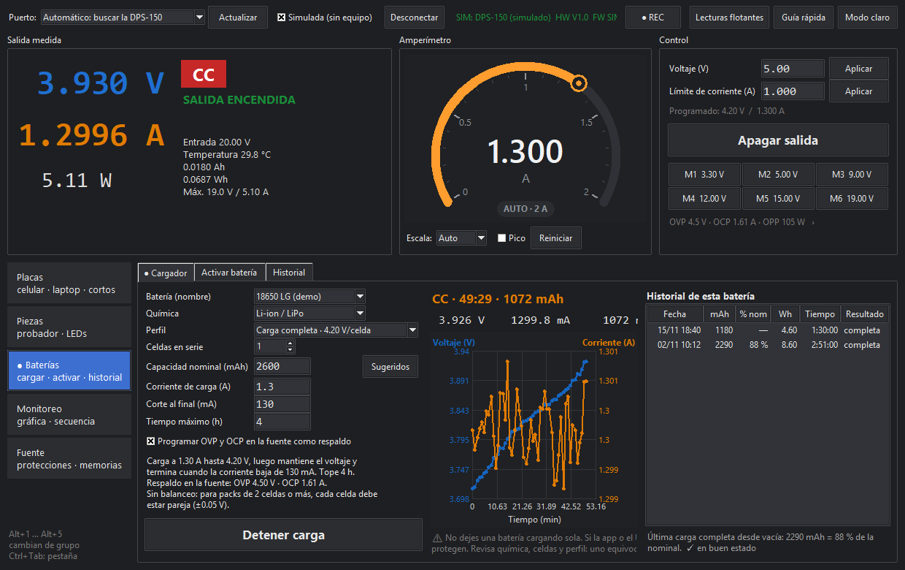
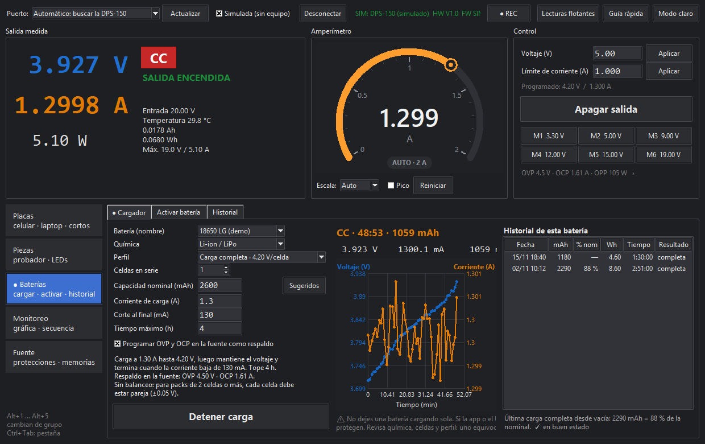
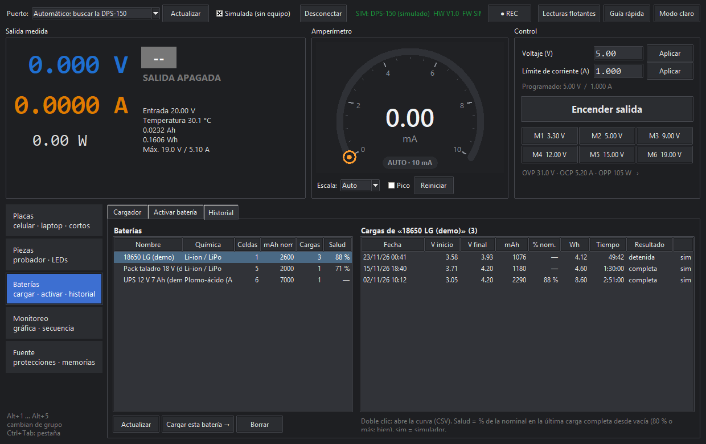
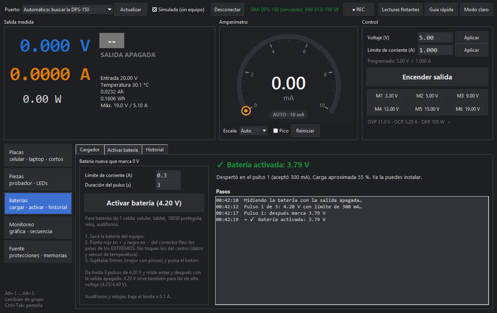
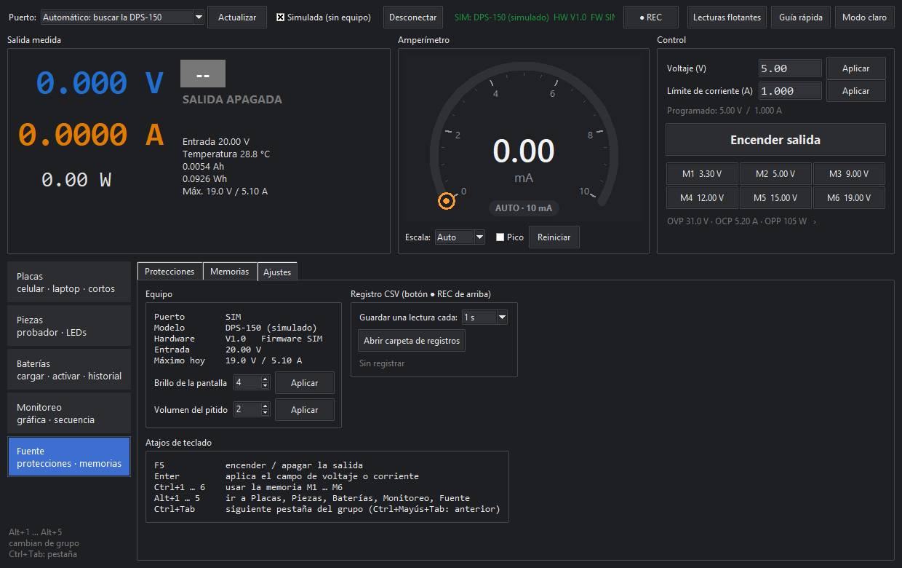
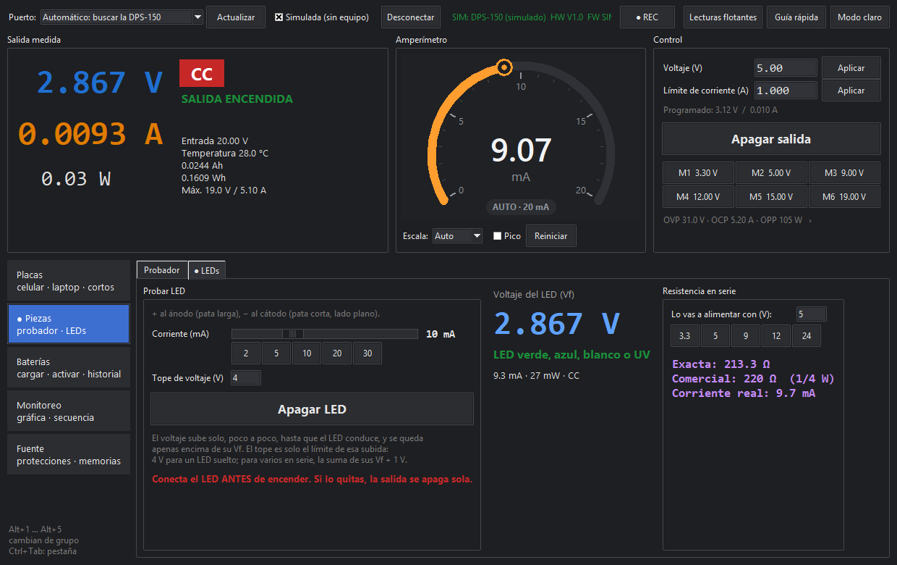
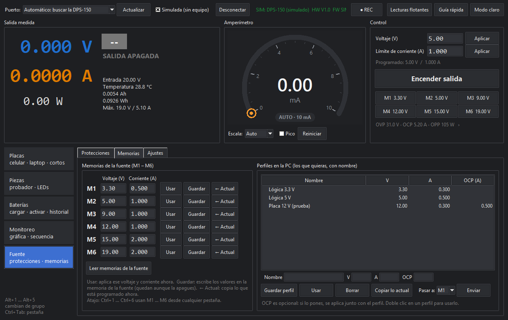
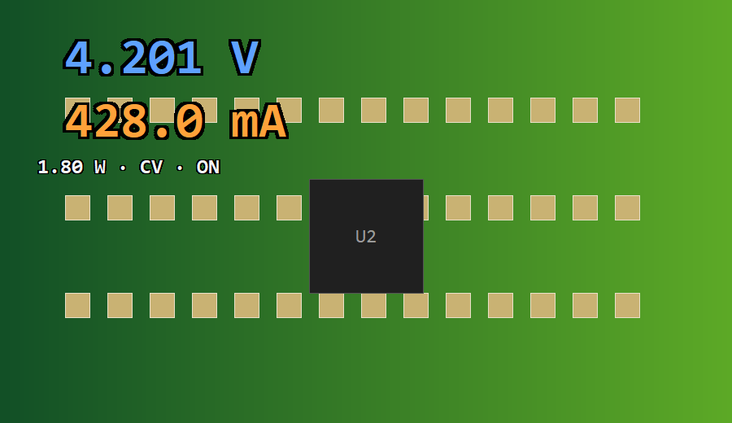

# Panel DPS-150

**Panel de control y diagnóstico para la fuente FNIRSI DPS-150, pensado para el banco de reparación de celulares, laptops y placas.**

*[English below](#english)*



> **Novedades de la v1.1:** cargador de baterías con corte automático, activación de baterías nuevas en 0 V, historial de baterías, arranque de laptop por el jack DC con veredicto, y una interfaz reorganizada en 5 grupos. Ver [CHANGELOG.md](CHANGELOG.md).

> ⚠️ **App no oficial.** No tiene relación con FNIRSI. Úsala bajo tu propio riesgo: una fuente de laboratorio puede dañar placas y componentes si se usa mal. Lee la sección [Seguridad](#seguridad).

---

## Qué hace

| | |
|---|---|
| **Lecturas en vivo** | Voltaje, corriente, potencia, CV/CC, Ah y Wh. Amperímetro de arco con escala automática o fija (10 mA a 5 A), marca de pico y modo claro u oscuro. |
| **Muestreo rápido** | Unas 10 lecturas por segundo; la fuente sola manda 2. |
| **Buscar corto** | Resistencia del riel en mΩ con cero de puntas, referencia (Δ), tono que sube al acercarte al corto y notas. |
| **Inyección escalonada** | 0.2 → 0.5 → 1 → 2 A sin pasar nunca del voltaje del riel, con límite de potencia. Modo **latido**: la corriente pulsa y el componente en corto parpadea en la cámara térmica. |
| **Celular** | Por el conector de batería: fuga antes de Power y **ola de arranque** con veredicto (normal, se queda fija, bucle, no reacciona). Compara contra la ola de un equipo bueno. |
| **Laptop** | Curva de la línea principal con veredicto (corto, fuga, sin consumo, normal). **Arranque por el jack DC:** mide el reposo, te pide presionar Power y clasifica el consumo en watts (no ve el adaptador, no reacciona, se queda en bajo, fija sin POST, reinicia en bucle, se apaga, corto al encender, normal), con dónde buscar la falla. |
| **Cargador de baterías** | Li-ion/LiPo, LiFePO4, plomo-ácido 6/12 V, gel y NiMH. CC/CV con corte automático, precarga para celdas muy descargadas, revisión antes de cargar (entrada, celdas, voltaje), OVP/OCP de respaldo en la fuente y 10 paros de emergencia. Mide mAh y Wh, guarda la curva y el historial por batería. |
| **Activar batería** | Despierta baterías nuevas de 1 celda que marcan 0 V porque su protección (PCM) viene cortada: pulsos de 4.20 V con límite de corriente, midiendo antes y después. Detecta corto, batería muerta o protección dañada. |
| **Historial de baterías** | Cada batería con nombre, su **salud** (% de la capacidad nominal en una carga desde vacía) y todas sus cargas. |
| **Barrido I-V** | Curva corriente/voltaje con zoom, cursor, tabla de puntos, escala log, veredicto automático y comparación con curvas guardadas. |
| **Probador de piezas** | Diodo, LED, zener, transistor BJT (NPN/PNP, patillaje, hFE), MOSFET (corto D-S, diodo interno, Vgs(th)) y capacitor (corto o fuga grande). Detecta si olvidaste voltear la pieza. |
| **LEDs en vivo** | El LED enciende con la corriente que elijas, muestra su Vf y calcula la resistencia en serie (valor comercial E24 y potencia). |
| **Secuencias** | Tabla de pasos (voltaje, corriente, duración, salida apagada), ejemplos listos (ciclos de arranque, tolerancia de 12 V, 5 V y 3.3 V, prueba larga) y secuencias propias guardables. |
| **Memorias** | M1–M6 de la fuente (leer, usar, guardar con verificación), perfiles ilimitados en la PC y atajos Ctrl+1…6. |
| **Lecturas flotantes** | Voltaje y corriente transparentes encima de cualquier ventana, por ejemplo la imagen del microscopio. Se pueden bloquear para que los clics pasen de largo. |
| **Más** | Protecciones OVP/OCP/OPP/OTP/LVP, gráficas con zoom, registro CSV (botón ● REC), guía rápida integrada. |

### Cómo está organizado
Una barra lateral con 5 grupos (**Alt+1 … Alt+5**). Cada grupo muestra solo sus pestañas:

| Grupo | Pestañas |
|---|---|
| **Placas** | Celular · Laptop · Cortos (medir resistencia / inyección escalonada) · Barrido I-V |
| **Piezas** | Probador · LEDs |
| **Baterías** | Cargador · Activar batería · Historial |
| **Monitoreo** | Gráfica · Secuencia |
| **Fuente** | Protecciones · Memorias · Ajustes |

Siempre a la vista: **● REC**, las memorias **M1–M6** con su voltaje y la línea **OVP · OCP · OPP**. El panel abre donde lo dejaste y marca con **●** la pestaña que tiene algo en marcha.

### Capturas

| Cargador de baterías | Historial de baterías |
|---|---|
|  |  |

| Laptop: arranque por el jack DC | Activar batería nueva en 0 V |
|---|---|
|  |  |

| Cortos: medir resistencia | Cortos: inyección escalonada |
|---|---|
|  |  |

| Celular: ola de arranque | Fuente › Ajustes |
|---|---|
|  |  |

| Barrido I-V | Probador de piezas |
|---|---|
|  |  |

| LEDs en vivo | Secuencias |
|---|---|
|  |  |

| Memorias | Modo claro |
|---|---|
|  |  |

**Lecturas flotantes sobre la imagen del microscopio:**



*Las capturas se hicieron con la fuente simulada (`--sim`); las baterías del historial son de ejemplo.*

---

## Instalación

**Necesitas:** Windows 10 u 11 y una FNIRSI DPS-150 con cable USB-C de datos.

### Opción A · Programa listo (recomendado, sin instalar nada)
1. Entra a **[Releases](../../releases/latest)** y descarga **`Panel DPS-150.exe`**.
2. Ponlo en una carpeta propia, por ejemplo `Documentos\Panel DPS-150`. Ahí guardará tus registros, curvas y configuración.
3. Doble clic en **`Panel DPS-150.exe`**.
   Si Windows muestra *"Windows protegió su PC"*, pulsa **Más información → Ejecutar de todas formas**. Aparece porque el programa no está firmado digitalmente.

### Opción B · Desde el código (para modificarlo)
Requiere [Python 3.10 o más nuevo](https://www.python.org/downloads/): al instalarlo, marca *"Add Python to PATH"*.

1. Descarga este repositorio: botón verde **Code → Download ZIP**, y luego clic derecho → **Extraer todo**.
2. Doble clic en **`Panel DPS-150.bat`**. La primera vez instala solo lo que falta (`pyserial`).

O desde una terminal:

```
pip install -r requirements.txt
python panel_dps150.py
```

**Probar sin la fuente:** `python panel_dps150.py --sim`, o marca *Simulada (sin equipo)* en el panel.

## Primer uso

1. **Abre el panel primero.**
2. **Después** conecta el cable USB de la fuente, o desconéctalo y vuelve a conectarlo. El panel la encuentra solo.

> La DPS-150 se desconecta del USB unos 4 segundos después de enchufarla si ningún programa abre su puerto. Por eso el panel tiene que estar abierto **antes**.

La **guía rápida** completa está en el botón *Guía rápida* del panel (archivo `GUIA.html`).

## Seguridad

Lo que el panel hace solo:
- En diodos, LEDs, zener, transistores, MOSFET, Buscar corto e Inyección, **el voltaje sube desde abajo** hasta que la pieza conduce. No enciende de golpe al voltaje máximo.
- La inyección se detiene al llegar a la potencia máxima y deja **OCP y OPP programadas dentro de la fuente**: si la app se cierra o se suelta el USB, la fuente corta sola.
- Con la salida encendida, una subida grande de voltaje (por ejemplo, 12 en vez de 1.2) pide confirmación.
- Al terminar cada prueba, apaga la salida y deja la fuente como estaba.
- El cargador programa OVP y OCP justo encima de lo pedido y se detiene solo: protección de la fuente, voltaje sobre el objetivo, salida apagada desde fuera, sin lecturas o USB perdido, sin corriente, corriente que cae de golpe (batería suelta o BMS), más del 130 % de la capacidad o tiempo máximo.

Lo que depende de ti:
- **Conecta y desconecta la placa con la salida APAGADA.** Con la salida encendida y sin nada conectado, el capacitor de salida de la fuente queda cargado y descarga un golpe de corriente al conectar. Esto quema LEDs aunque haya límite de corriente.
- Revisa la polaridad.
- Nunca inyectes más voltaje que el del riel.
- **No dejes una batería cargando sola.** Si se suelta el USB, la fuente puede seguir con la salida encendida (con el límite puesto): apágala a mano. El cargador no balancea celdas.

## Limitaciones conocidas

- Probado con una DPS-150, **firmware V1.2**, en Windows 11. En Linux y macOS no está probado.
- La fuente sola manda unas 2 lecturas por segundo; con muestreo rápido, unas 10. No ve picos de milisegundos.
- El voltaje máximo depende del adaptador de entrada: con uno de 20 V llega a unos 19.7 V, con uno de 12 V a unos 11.8 V.
- No distingue corrientes menores de ~1–2 mA.
- Con el firmware V1.2, la temperatura interna que manda la fuente no es válida (unos −16 °C). El panel muestra *sin dato válido*.
- El probador de capacitores no mide µF ni ESR: solo detecta cortos y fugas grandes.
- La DPS-150 no absorbe corriente: el cargador mide la capacidad al **cargar** (desde vacía), no puede descargar.
- Con la fuente real se probó la carga de una Li-ion 18650 (precarga → CC → CV hasta 4.10 V) y la lectura del voltaje de la batería con la salida apagada; **todavía falta una carga completa con corte automático**. Buscar corto, la inyección, el probador de transistores y MOSFET, el plomo, el NiMH, la activación de baterías y el arranque de laptop están probados **solo con el simulador**: si los usas, vigila y cuéntanos cómo te fue.
- Para laptops de 19–20 V la DPS-150 necesita un cargador USB-C de 20 V en su entrada.

## Cómo está hecho

| Archivo | Qué contiene |
|---|---|
| `dps150.py` | Protocolo serie de la fuente. Se puede usar solo, desde tus propios scripts. |
| `dps150_sim.py` | Fuente simulada, con modelos de resistencia, diodo, zener, batería (incluso «dormida») y laptop, para probar sin equipo. |
| `panel_dps150.py` | Ventana principal, gráficas, amperímetro, memorias, Buscar corto, secuencias y temas. |
| `probador.py` | Probador de piezas y LEDs en vivo. |
| `diagnostico.py` | Celular, Inyección (con latido), Laptop (curva y arranque) y Activar batería. |
| `cargador.py` | Cargador de baterías e historial. |
| `barrido.py` | Barrido I-V. |
| `superposicion.py` | Lecturas flotantes transparentes. |
| `GUIA.html` | Guía rápida. |

Uso del módulo desde Python:

```python
from dps150 import DPS150, puerto_dps150
fuente = DPS150(puerto_dps150())
fuente.abrir()
fuente.fijar_corriente(0.1)
fuente.fijar_voltaje(3.3)
fuente.salida(True)
print(fuente.lectura()["iout"])
fuente.salida(False)
fuente.cerrar()
```

## Contribuir

¡Las mejoras son bienvenidas! Lee [CONTRIBUTING.md](CONTRIBUTING.md). Hay ideas abiertas, como una libreta de casos de reparación o más pruebas en el probador.

## Créditos y licencia

- El protocolo de la DPS-150 se basa en el trabajo de **cho45**, [fnirsi-dps-150](https://github.com/cho45/fnirsi-dps-150) (licencia MIT). Este proyecto lo reimplementa en Python.
- La idea del cargador de baterías viene de [pazyuk/dps-150](https://github.com/pazyuk/dps-150) (app para macOS, GPL-3.0). El código de este proyecto es propio, no copia el suyo.
- Las técnicas de diagnóstico siguen lo que publican los talleres y foros de reparación: iFixit, repair.wiki, Badcaps, EEVblog y Rossmann Group.
- Licencia **MIT**: ver [LICENSE](LICENSE).
- *FNIRSI y DPS-150 son marcas de su fabricante. Este proyecto no está afiliado ni respaldado por FNIRSI.*

---

<a id="english"></a>
## English

**Control and diagnostics panel for the FNIRSI DPS-150 bench power supply, built for phone, laptop and board repair benches.** The interface is in Spanish.

> ⚠️ **Unofficial app**, not affiliated with FNIRSI. Use at your own risk.

**Features:** live readings with an arc ammeter and fast sampling (~10 readings/s instead of 2); short finder in mΩ with probe zeroing, reference and tone; stepped current injection (0.2 → 2 A) that never exceeds the rail voltage, with a **pulsed "heartbeat" mode** so the shorted part blinks in a thermal camera; phone mode (leakage before Power, boot-current waveform with automatic verdict, compare against a known-good phone); laptop main-rail curve with verdict and **boot test through the DC jack** (classifies the power draw after pressing Power: no adapter detected, no reaction, stuck low, stuck without POST, boot loop, shuts down, short at power-on, normal); **battery charger** (Li-ion/LiPo, LiFePO4, lead-acid, gel, NiMH) with CC/CV auto cutoff, precharge, pre-checks, OVP/OCP backstop in the supply, 10 emergency stops, mAh/Wh and per-battery history with health %; **wake-up for new 1-cell batteries** that read 0 V because their protection board ships tripped; interactive I-V sweep (zoom, cursor, table, log scale, verdict, reference curves); component tester (diode, LED, zener, BJT pinout and hFE, MOSFET, capacitor) that detects if you forgot to flip the part; live LED tester with series-resistor calculator; sequences; memories M1–M6; transparent always-on-top readings over your microscope view; light and dark themes. The UI is grouped in a sidebar: Boards, Parts, Batteries, Monitoring, Supply (Alt+1…5).

**Install (Windows 10/11):** download **`Panel DPS-150.exe`** from [Releases](../../releases/latest) and run it, no Python needed. If Windows SmartScreen appears, click *More info → Run anyway* (the app is not code-signed). From source (Python 3.10+): `pip install -r requirements.txt`, then `python panel_dps150.py`. Try it without hardware with `--sim`.

**Build the .exe yourself:** `pip install pyinstaller`, then `pyinstaller --onefile --windowed --name "Panel DPS-150" --icon docs/icono.ico --add-data "GUIA.html;." --add-data "docs/icono.ico;." panel_dps150.py`

**Important:** open the panel **before** plugging in the supply's USB cable. The DPS-150 drops off USB about 4 s after plugging in if no program opens its port.

**Safety:** connect and disconnect boards with the output **OFF**. With the output on and nothing connected, the supply's output capacitor stays charged and dumps a current spike into the part (this kills LEDs even with a current limit). All tester and injection modes ramp the voltage up from low, and injection programs OCP/OPP inside the supply as a backstop.

**Tested:** with a real DPS-150 (FW V1.2) for readings, control, battery voltage with output off, and a Li-ion 18650 charge up to the CV phase (a full charge with automatic cutoff is still pending). The short finder, injection, BJT/MOSFET tester, lead-acid/NiMH charging, battery wake-up and the laptop boot test are so far **tested only against the built-in simulator**.

**Credits:** the DPS-150 serial protocol is based on [cho45/fnirsi-dps-150](https://github.com/cho45/fnirsi-dps-150) (MIT), reimplemented in Python. The battery charger idea comes from [pazyuk/dps-150](https://github.com/pazyuk/dps-150) (macOS, GPL-3.0); this code is original. MIT license.
