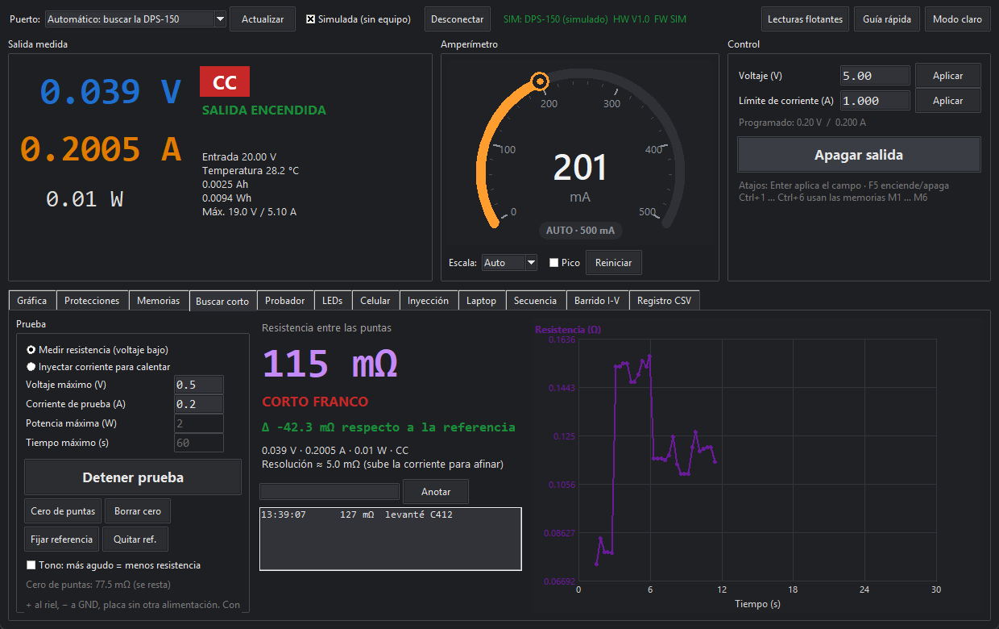
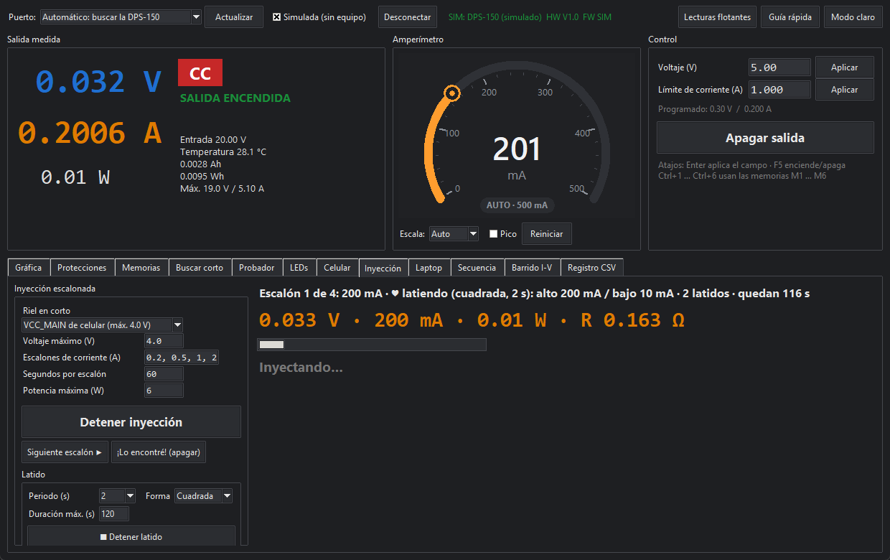
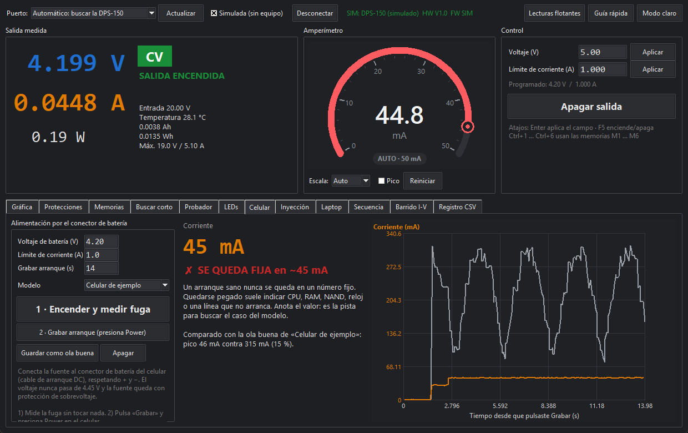
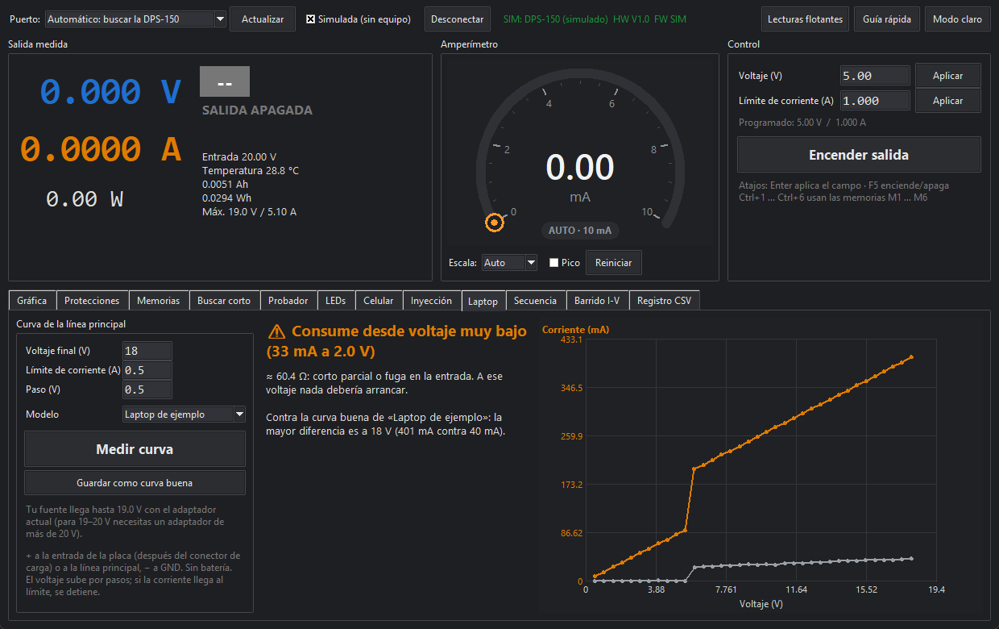
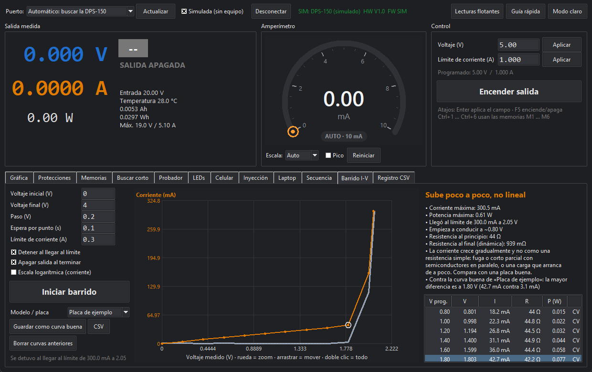
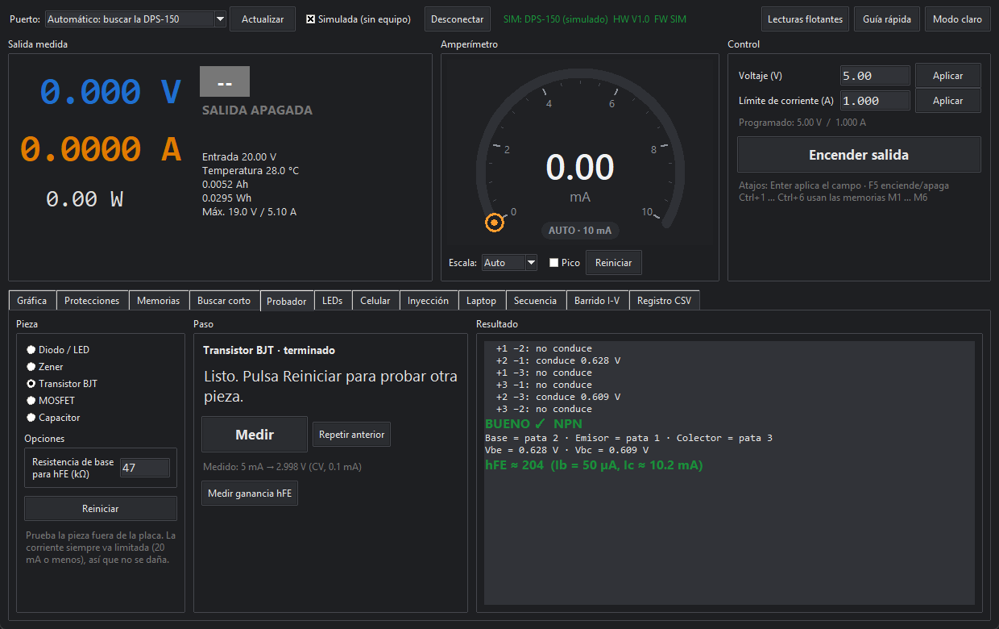
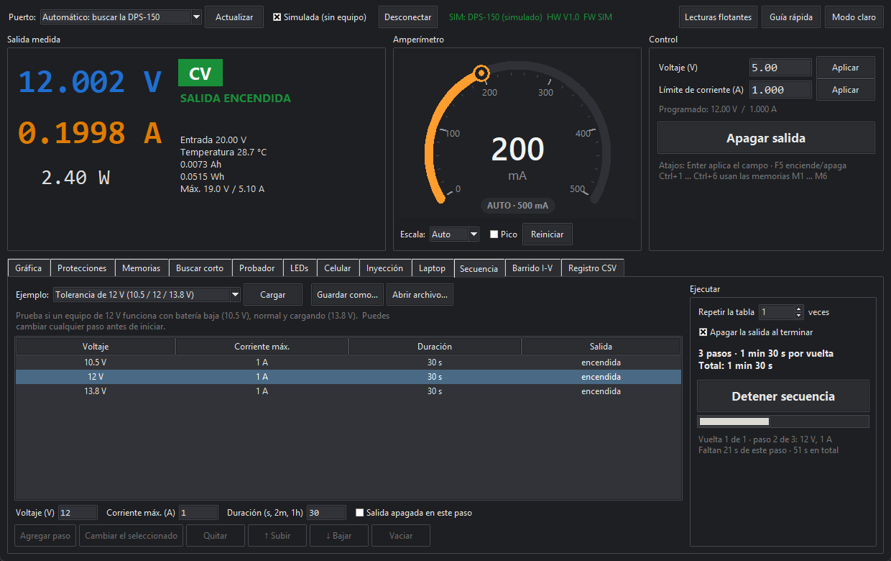
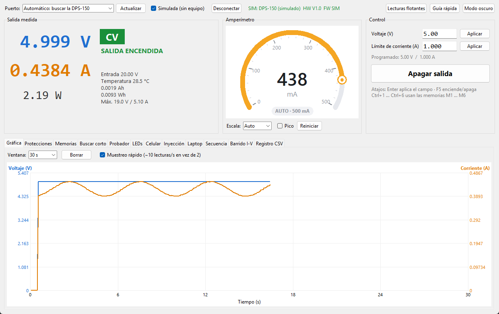

# Panel DPS-150

**Panel de control y diagnóstico para la fuente FNIRSI DPS-150, pensado para el banco de reparación de celulares, laptops y placas.**

*[English below](#english)*


> ⚠️ **App no oficial.** No tiene relación con FNIRSI. Úsala bajo tu propio riesgo: una fuente de laboratorio puede dañar placas y componentes si se usa mal. Lee la sección [Seguridad](#seguridad).

---

## Qué hace

| | |
|---|---|
| **Lecturas en vivo** | Voltaje, corriente, potencia, CV/CC, Ah y Wh. Amperímetro de arco con escala automática o fija (10 mA a 5 A), marca de pico y modo claro u oscuro. |
| **Muestreo rápido** | Unas 10 lecturas por segundo; la fuente sola manda 2. |
| **Buscar corto** | Resistencia del riel en mΩ con cero de puntas, referencia (Δ), tono que sube al acercarte al corto y notas. |
| **Inyección escalonada** | 0.2 → 0.5 → 1 → 2 A sin pasar nunca del voltaje del riel, con límite de potencia. Modo **latido**: la corriente pulsa y el componente en corto parpadea en la cámara térmica. |
| **Celular** | Por el conector de batería: fuga antes de Power y **ola de arranque** con veredicto (normal, se queda fija, bucle, no reacciona). Compara contra la ola de un equipo bueno. |
| **Laptop** | Curva de la línea principal con veredicto (corto, fuga, sin consumo, normal) y comparación con una placa buena. |
| **Barrido I-V** | Curva corriente/voltaje con zoom, cursor, tabla de puntos, escala log, veredicto automático y comparación con curvas guardadas. |
| **Probador de piezas** | Diodo, LED, zener, transistor BJT (NPN/PNP, patillaje, hFE), MOSFET (corto D-S, diodo interno, Vgs(th)) y capacitor (corto o fuga grande). Detecta si olvidaste voltear la pieza. |
| **LEDs en vivo** | El LED enciende con la corriente que elijas, muestra su Vf y calcula la resistencia en serie (valor comercial E24 y potencia). |
| **Secuencias** | Tabla de pasos (voltaje, corriente, duración, salida apagada), ejemplos listos (ciclos de arranque, tolerancia de 12 V, 5 V y 3.3 V, prueba larga) y secuencias propias guardables. |
| **Memorias** | M1–M6 de la fuente (leer, usar, guardar con verificación), perfiles ilimitados en la PC y atajos Ctrl+1…6. |
| **Lecturas flotantes** | Voltaje y corriente transparentes encima de cualquier ventana, por ejemplo la imagen del microscopio. Se pueden bloquear para que los clics pasen de largo. |
| **Más** | Protecciones OVP/OCP/OPP/OTP/LVP, gráficas con zoom, registro CSV y guía rápida integrada. |

### Capturas

| Buscar corto | Inyección en latido |
|---|---|
|  |  |

| Celular: ola de arranque | Laptop: curva de la línea principal |
|---|---|
|  |  |

| Barrido I-V | Probador de piezas |
|---|---|
|  |  |

| LEDs en vivo | Secuencias |
|---|---|
|  |  |

| Memorias | Modo claro |
|---|---|
|  |  |

**Lecturas flotantes sobre la imagen del microscopio:**


*Las capturas se hicieron con la fuente simulada (`--sim`).*

---

## Instalación

**Requisitos:** Windows 10 u 11, [Python 3.10 o más nuevo](https://www.python.org/downloads/) (marca *"Add Python to PATH"* al instalarlo) y una FNIRSI DPS-150 con cable USB-C de datos.

1. Descarga este repositorio: botón verde **Code → Download ZIP**. Descomprímelo.
2. Doble clic en **`Panel DPS-150.bat`**. La primera vez instala solo lo que falta (`pyserial`).

O desde una terminal:

```
pip install -r requirements.txt
python panel_dps150.py
```

**Probar sin la fuente:** `python panel_dps150.py --sim`, o marca *Simulada (sin equipo)* en el panel.

## Primer uso

1. **Abre el panel primero.**
2. **Después** conecta el cable USB de la fuente, o desconéctalo y vuelve a conectarlo. El panel la encuentra solo.

> La DPS-150 se desconecta del USB unos 4 segundos después de enchufarla si ningún programa abre su puerto. Por eso el panel tiene que estar abierto **antes**.

La **guía rápida** completa está en el botón *Guía rápida* del panel (archivo `GUIA.html`).

## Seguridad

Lo que el panel hace solo:
- En diodos, LEDs, zener, transistores, MOSFET, Buscar corto e Inyección, **el voltaje sube desde abajo** hasta que la pieza conduce. No enciende de golpe al voltaje máximo.
- La inyección se detiene al llegar a la potencia máxima y deja **OCP y OPP programadas dentro de la fuente**: si la app se cierra o se suelta el USB, la fuente corta sola.
- Con la salida encendida, una subida grande de voltaje (por ejemplo, 12 en vez de 1.2) pide confirmación.
- Al terminar cada prueba, apaga la salida y deja la fuente como estaba.

Lo que depende de ti:
- **Conecta y desconecta la placa con la salida APAGADA.** Con la salida encendida y sin nada conectado, el capacitor de salida de la fuente queda cargado y descarga un golpe de corriente al conectar. Esto quema LEDs aunque haya límite de corriente.
- Revisa la polaridad.
- Nunca inyectes más voltaje que el del riel.

## Limitaciones conocidas

- Probado con una DPS-150, **firmware V1.2**, en Windows 11. En Linux y macOS no está probado.
- La fuente sola manda unas 2 lecturas por segundo; con muestreo rápido, unas 10. No ve picos de milisegundos.
- El voltaje máximo depende del adaptador de entrada: con uno de 20 V llega a unos 19.7 V, con uno de 12 V a unos 11.8 V.
- No distingue corrientes menores de ~1–2 mA.
- Con el firmware V1.2, la temperatura interna que manda la fuente no es válida (unos −16 °C). El panel muestra *sin dato válido*.
- El probador de capacitores no mide µF ni ESR: solo detecta cortos y fugas grandes.

## Cómo está hecho

| Archivo | Qué contiene |
|---|---|
| `dps150.py` | Protocolo serie de la fuente. Se puede usar solo, desde tus propios scripts. |
| `dps150_sim.py` | Fuente simulada, con modelos de resistencia, diodo y zener, para probar sin equipo. |
| `panel_dps150.py` | Ventana principal, gráficas, amperímetro, memorias, Buscar corto, secuencias y temas. |
| `probador.py` | Probador de piezas y LEDs en vivo. |
| `diagnostico.py` | Pestañas Celular, Inyección (con latido) y Laptop. |
| `barrido.py` | Barrido I-V. |
| `superposicion.py` | Lecturas flotantes transparentes. |
| `GUIA.html` | Guía rápida. |

Uso del módulo desde Python:

```python
from dps150 import DPS150, puerto_dps150
fuente = DPS150(puerto_dps150())
fuente.abrir()
fuente.fijar_corriente(0.1)
fuente.fijar_voltaje(3.3)
fuente.salida(True)
print(fuente.lectura()["iout"])
fuente.salida(False)
fuente.cerrar()
```

## Contribuir

¡Las mejoras son bienvenidas! Lee [CONTRIBUTING.md](CONTRIBUTING.md). Hay ideas abiertas, como una libreta de casos de reparación o más pruebas en el probador.

## Créditos y licencia

- El protocolo de la DPS-150 se basa en el trabajo de **cho45**, [fnirsi-dps-150](https://github.com/cho45/fnirsi-dps-150) (licencia MIT). Este proyecto lo reimplementa en Python.
- Las técnicas de diagnóstico siguen lo que publican los talleres y foros de reparación: iFixit, repair.wiki, Badcaps, EEVblog y Rossmann Group.
- Licencia **MIT**: ver [LICENSE](LICENSE).
- *FNIRSI y DPS-150 son marcas de su fabricante. Este proyecto no está afiliado ni respaldado por FNIRSI.*

---

<a id="english"></a>
## English

**Control and diagnostics panel for the FNIRSI DPS-150 bench power supply, built for phone, laptop and board repair benches.** The interface is in Spanish.

> ⚠️ **Unofficial app**, not affiliated with FNIRSI. Use at your own risk.

**Features:** live readings with an arc ammeter and fast sampling (~10 readings/s instead of 2); short finder in mΩ with probe zeroing, reference and tone; stepped current injection (0.2 → 2 A) that never exceeds the rail voltage, with a **pulsed "heartbeat" mode** so the shorted part blinks in a thermal camera; phone mode (leakage before Power, boot-current waveform with automatic verdict, compare against a known-good phone); laptop main-rail curve with verdict; interactive I-V sweep (zoom, cursor, table, log scale, verdict, reference curves); component tester (diode, LED, zener, BJT pinout and hFE, MOSFET, capacitor) that detects if you forgot to flip the part; live LED tester with series-resistor calculator; sequences; memories M1–M6; transparent always-on-top readings over your microscope view; light and dark themes.

**Install (Windows 10/11, Python 3.10+):** download the ZIP, then double-click `Panel DPS-150.bat`, or run `pip install -r requirements.txt` and then `python panel_dps150.py`. Try it without hardware with `--sim`.

**Important:** open the panel **before** plugging in the supply's USB cable. The DPS-150 drops off USB about 4 s after plugging in if no program opens its port.

**Safety:** connect and disconnect boards with the output **OFF**. With the output on and nothing connected, the supply's output capacitor stays charged and dumps a current spike into the part (this kills LEDs even with a current limit). All tester and injection modes ramp the voltage up from low, and injection programs OCP/OPP inside the supply as a backstop.

**Credits:** the DPS-150 serial protocol is based on [cho45/fnirsi-dps-150](https://github.com/cho45/fnirsi-dps-150) (MIT), reimplemented in Python. MIT license.
